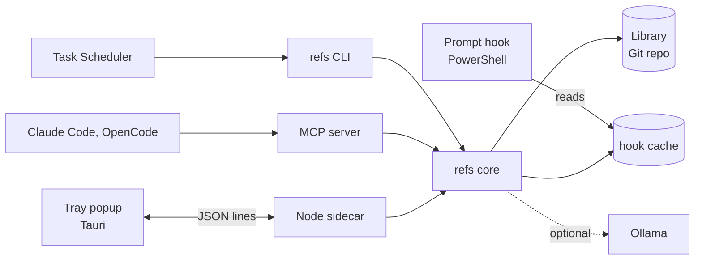

# refs

A personal cheat sheet index for Windows. It gathers every reference note (Markdown, text, Word, PDF, screenshots) into one Git-tracked library, works out what kind of project you are in, and puts the matching sheets in front of you: one line in the PowerShell prompt, a session index and MCP tools for coding agents, and a hotkey popup with live search. It also tracks which sheets you actually use, and keeps nudging you about the ones you don't.

## At a glance

**Stack:** TypeScript on Node 24 (run directly, no build step), SQLite FTS5, local embeddings and LLM through Ollama, MCP, PowerShell, and a Tauri v2 tray app with a Vue frontend.

- **Hybrid search that degrades gracefully.** Keyword and embedding rankings are fused with reciprocal rank fusion and boosted for the current project; when Ollama is down every surface falls back to keyword search and says so.
- **No background service.** Slow work runs in `refs index` on a schedule; the prompt hook reads a cache laid out for a plain string search and starts Node only to scan a project it has not seen yet, hidden in the background.
- **Untrusted text handled as data.** Every import is secret-scanned (OCR text included), model replies must match strict schemas, agents get sheet text marked as reference data in a wrapper the text cannot close early, and the popup renders Markdown in a sandboxed sidecar with links and images locked down.
- **A popup under 300 ms by design.** The window is pre-rendered and hidden; measured at 8 ms from hotkey to visible. All logic stays in Node and is shared with the CLI.
- **An installer that shows its plan.** `refs install` lists every change to profiles, scheduler, PATH, agent configs and startup items, supports `--dry-run`, backs files up and is safe to run twice.
- **Tests that never touch the real machine.** 133 tests run in temporary sandboxes against a fake Ollama server and a fake system layer, in about 25 s.

More detail: [architecture](docs/architecture.md) (diagrams and trust boundaries) and [design decisions](docs/decisions.md) (why, and what each choice costs). The full spec is [SPEC.md](SPEC.md).

## What it does

```text
refs [node, docker, playwright] 4 sheets (1 stale) | gap: playwright | try: "Docker volumes" | refs for .
```

That line appears when you `cd` into a project under one of your registered roots. Tags come from file signatures in `rules.json` (a `Dockerfile` means docker, `playwright` in `package.json` means playwright); a gap is a tag with no sheet; `try:` rotates through relevant sheets you have not used in 30 days and have not marked learned.

| Command | What it does |
|---|---|
| `refs add <file> [--tags a,b]` | Import a file: hash, extract, secret-scan, move into the library, commit |
| `refs index [--rebuild]` | Import the inbox, sync edits, update the index and embeddings, scan projects |
| `refs search <query>` | Hybrid search, boosted for the project you are in |
| `refs for <path or "tags">` | Sheets by tag, gaps and unused reminders |
| `refs open <id> [--section n]` | Print a sheet or one section; counts as use |
| `refs review` | Confirm the tags a local LLM proposed for new imports |
| `refs suggest [path]` | LLM ideas for missing sheets; save one as a draft |
| `refs approve`, `verify`, `learned` | Promote a draft, reset the stale clock, stop reminders |
| `refs context --cwd <dir>` | Compact index for an agent's session start |
| `refs install [--dry-run]` | Prompt hook, scheduled task, PATH, agent hooks, popup at logon |
| `refs doctor` | Check config, library, index, Ollama, hook, schedule, agents and popup |

Agents use the MCP server (`refs_search`, `refs_get`, `refs_for_project`), and Claude Code gets the matched sheets at session start. The popup (default hotkey Ctrl+Alt+Space, set in `config.json`) searches as you type, previews a section, and marks sheets learned or verified.

## How it is built



Everything shares `packages/core`; the CLI, MCP server and popup sidecar are thin entry points. See [docs/architecture.md](docs/architecture.md) for the full system, component, sequence and data diagrams.

```text
packages/core      library, import, extraction, secret scan, index and search, AI, detection, install
packages/cli       the refs command
packages/mcp       MCP server over stdio
packages/sidecar   the popup's Node backend
apps/popup         Tauri v2 tray app (Rust shell, Vue frontend)
shell              PowerShell prompt hook
tools/check.cmd    typecheck, popup build check and tests
```

## Development

Requires Windows 11, Node 24, Git and PowerShell 7. Ollama (with `bge-m3` and a chat and vision model) is optional. Building the popup needs Rust and the MSVC build tools.

```powershell
npm install
tools\check.cmd
npm run popup:build
```

`tools\check.cmd` runs the TypeScript typecheck, the popup frontend build with `cargo check`, and the test suite.
