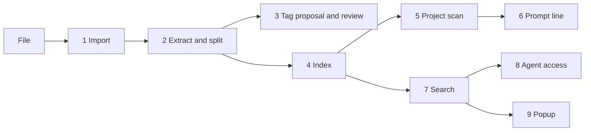

# refs

refs is a Windows tool that moves every cheat sheet and reference note (Markdown, text, Word, PDF, screenshots) into one Git-tracked library and shows the sheets that match the project you are in: a line in the PowerShell prompt, an index and MCP tools for coding agents, and a hotkey popup with live search. It tracks which sheets you actually open and reminds you of relevant ones you have not used, with hybrid keyword and embedding search on a local Ollama that falls back to keyword search when Ollama is down, a secret scan on every import, and no background service.

## Demo

**2-minute walkthrough:** [Watch on Loom](TODO-LOOM-URL)

## Tech stack

Versions are the ones declared in the manifests or resolved in `package-lock.json` and `apps/popup/src-tauri/Cargo.lock`.

**Runtime**
- Node.js 24 or newer (`engines` in `package.json`). Node runs the `.ts` sources directly through type stripping; there is no build step for the CLI, MCP server or sidecar.
- Windows 11. The code calls `schtasks.exe`, `reg.exe`, `explorer.exe`, `conhost.exe` and `powershell.exe`, and the popup targets `x86_64-pc-windows-msvc`.
- Git on PATH (the library is a Git repo).
- PowerShell 7 for the prompt hook; Windows PowerShell 5.1 is best effort (`shell/refs-hook.ps1`).

**Languages**
- TypeScript, typechecked only (`tsconfig.json` sets `noEmit` and `erasableSyntaxOnly`).
- Rust for the popup shell, toolchain pinned to 1.99.0 (`apps/popup/src-tauri/rust-toolchain.toml`).
- PowerShell for the prompt hook.

**Frameworks and libraries**
- zod 4.6.7: config, manifest, rules and model reply schemas.
- better-sqlite3 13.0.3: the search index.
- mammoth 1.13.0 (DOCX) and pdfjs-dist 6.4.299 (PDF text and page rendering for OCR; it uses the optional @napi-rs/canvas 1.0.12).
- markdown-it 15.0.2: popup preview rendering in the sidecar.
- @modelcontextprotocol/server 2.3.1: MCP server over stdio.
- Vue 3.5.43 runtime build, copied into the popup by `apps/popup/build.ts` (no bundler).
- Tauri 2.12.1 with tauri-plugin-global-shortcut 2.4.0 and tauri-plugin-single-instance 2.5.2; serde 1.0.229 and serde_json 1.0.151.
- Node built-ins the code relies on: `node:test`, `parseArgs` from `node:util`, `stripTypeScriptTypes` from `node:module`, `path.matchesGlob` and global `fetch`.

**Storage**
- Library folder (a Git repo): sheet files, `manifest.json`, `rules.json`, `tags.json`, `gap-ignores.json`, OCR text.
- `%LOCALAPPDATA%\refs\index.db`: SQLite in WAL mode with an FTS5 table and embedding vectors stored as float32 blobs.
- JSON and JSON Lines files for the hook cache, usage log and config.

**Models and providers**
- Ollama HTTP API (`/api/version`, `/api/tags`, `/api/embed`, `/api/chat`) at `http://localhost:11434` by default.
- Default models in `packages/core/src/config.ts`: `bge-m3` for embeddings, `mistral-small3.2:24b` for chat (tags, suggestions, drafts) and for vision (OCR).
- Optional: chat through any OpenAI-compatible `/v1/chat/completions` endpoint (`ollama.chatApi: "openai"` and `ollama.chatHost`).

**Testing and tooling**
- `node:test` with a fake Ollama HTTP server (`packages/core/test/fakeollama.ts`) and a fake system layer (`packages/core/test/helpers.ts`).
- @modelcontextprotocol/client 2.3.1 (MCP tests), typescript 7.0.2, @types/node 24.19.2, @types/better-sqlite3 9.6.0.
- `tools\check.cmd`: typecheck, popup frontend build plus `cargo check`, and the test suite.
- `tools/bench.ts` (speed budgets) and `tools/eval.ts` (model quality against real Ollama), with offline tests of their scoring in `tools/test/eval.test.ts`.

## Architecture and data flow

A file enters through `refs add` or the library's inbox folder. refs hashes it, extracts text (OCR through the vision model for images and scanned PDF pages), scans the text for secrets, moves the file into the library, records it in `manifest.json` and commits. Without tags given on the command line, the chat model proposes a title and tags, and the sheet waits as `pending` until `refs review`. `refs index`, run by hand or by Task Scheduler at logon and every 30 minutes, brings the manifest in line with edited or renamed files, imports the inbox, rebuilds the FTS5 rows of changed sheets, embeds new section text, scans every project under the registered roots with the signature rules, and writes `hook-cache.json`.

Everything after that reads precomputed data. The PowerShell prompt hook finds the current project in the hook cache with a plain string search and prints one line. Search fuses a keyword ranking and a vector ranking. Agents get a session-start index from `refs context` and fetch sheets through three MCP tools. The popup, a Tauri tray app, relays JSON lines to a Node sidecar that reuses the same core library. Opening a sheet, an agent fetch or marking it learned appends to `usage.jsonl`, which drives the "try:" reminders.

| Step | Component | Files | Input | Output |
| --- | --- | --- | --- | --- |
| 1 | Import | `packages/core/src/import.ts`, `inbox.ts`, `secrets.ts` | A `.md`, `.txt`, `.docx`, `.pdf`, `.png` or `.jpg` file | File in `sheets\`, a `manifest.json` entry, a Git commit; or the file parked in `inbox\_blocked` or `inbox\_duplicates` with a reason file |
| 2 | Extract and split | `packages/core/src/extract/`, `chunk.ts`, `library.ts` | File bytes | Sections split by heading (Markdown, DOCX), by page (PDF) or one section; OCR text saved as `ocr\<sha256>.txt` in the library |
| 3 | Tag proposal and review | `packages/core/src/llm.ts`, `review.ts` | The first 6,000 characters of text and the tag vocabulary | A `proposal` on the pending sheet; `refs review` makes it `verified` |
| 4 | Index | `packages/core/src/indexer.ts`, `db.ts`, `embed.ts` | Manifest and sections | `index.db`: FTS5 rows and vectors keyed by text hash and model |
| 5 | Project scan | `packages/core/src/rules.ts`, `detect.ts`, `hookcache.ts`, `usage.ts`, `gaps.ts` | Folders under the configured roots, `rules.json`, `usage.jsonl` | `hook-cache.json`: tags, sheet and stale counts, gaps and the "try:" list per project |
| 6 | Prompt line | `shell/refs-hook.ps1` | Current folder and `hook-cache.json` | One printed line; `last-project.json` |
| 7 | Search | `packages/core/src/search.ts` | Query and the last project's tags | Ranked sections, keyword only or hybrid |
| 8 | Agent access | `packages/mcp/src/server.ts`, `packages/core/src/agent.ts`, `context.ts` | MCP tool calls; the SessionStart hook | Sheet data inside a `<reference_data>` wrapper; an `agent_fetch` usage event |
| 9 | Popup | `apps/popup/src-tauri/src/main.rs`, `apps/popup/src/`, `packages/sidecar/src/` | Hotkey and typed query | Live results, sanitized previews, learned, verified and approve actions |



**Patterns in the code**
- Reciprocal rank fusion, `packages/core/src/search.ts` `fuseRanks`: the keyword and vector rankings are merged by summing 1 / (60 + rank), then sections of sheets tagged like the current project are multiplied by 1.5 and stale sheets by 0.5.
- Content-addressed caching, `packages/core/src/db.ts`, `library.ts`: vectors are keyed by the SHA256 of the embedded text and the model name, and extracted text by the file's SHA256, so an edit only redoes the sections that changed.
- Single-writer lock with atomic writes, `packages/core/src/lock.ts` `acquireLock` and `util.ts` `writeFileAtomic`: one process writes at a time; a lock left by a dead process is taken over; files are written to a temp file and renamed.
- Plan, then apply, behind an interface, `packages/core/src/install.ts` `planInstall` and `agents.ts` `planAgents`: `refs install` builds and prints every change first, and all machine access goes through `SystemOps`, which tests replace with a fake.
- Schema-checked model output, `packages/core/src/llm.ts`, `suggest.ts`, `drafts.ts`: each reply must parse against a strict zod schema (also sent to Ollama as the JSON schema); a bad reply gets one retry at temperature 0, then is discarded.
- Untrusted text wrapped as data, `packages/core/src/agent.ts` `wrapReferenceData`, `llm.ts` `wrapDocument`, `suggest.ts` `wrapFiles`: text goes into a tagged wrapper, and any copy of the wrapper's tag inside the text is altered so it cannot end the wrapper early.
- Precomputed cache for a hot path, `packages/core/src/hookcache.ts` `serializeHookCache`: the cache is valid JSON with one project per line, so the prompt hook finds its project with an ordinal string search instead of parsing JSON.
- Supervised child process over JSON lines, `apps/popup/src-tauri/src/main.rs` `supervise`: the Rust shell starts the Node sidecar, relays its stdout lines to the window, and restarts it at most 5 times a minute.
- Sequence numbers for out-of-order replies, `apps/popup/src/logic.ts` `SearchScheduler` and `packages/sidecar/src/handlers.ts`: every keystroke gets a keyword pass at once and a hybrid pass after a 250 ms pause; replies for older keystrokes are dropped.

## Results

| Metric | Result | Conditions | Source |
| --- | --- | --- | --- |
| Tests passing | 142 of 142 | `tools\check.cmd` started from Git Bash on Windows 11, Node 24.21.0, 2026-11-03; the test step reported 27.4 s | Output of `tools\check.cmd` (`node --test` summary) |

| Prompt hook, entering a project | 7.7 ms median, 10.5 ms p95 (budget 50 ms) | 50 runs in one PowerShell 7.6.9 session, 42 cached projects; the first prompt of a fresh session took 79 ms median over 10 sessions | `npm run bench`, `docs/results/bench-2026-11-03-2008.json` |
| Keyword search | 16 ms median, 17.5 ms p95 (budget 100 ms) | 120 queries through the popup's sidecar, request to reply, 2,401 sections | same |
| Hybrid search, Ollama warm | 191 ms median, 230 ms p95 (budget 1 s) | same queries, bge-m3 on Ollama 0.40.8, 2,401 embedded sections | same |
| Popup, hotkey to visible | 8.2 ms median, 11.7 ms p95 key press to visible; 16.8 ms median, 18.9 ms p95 hotkey to painted (budget 300 ms) | 20 presses of Ctrl+Alt+Shift+F12 from outside the app, none missed; painted is the popup's own log after two frames | `npm run bench -- --skip hook,search,hybrid,cli`, `docs/results/bench-2026-11-03-2014.json` |
| Retrieval quality | hybrid: right section first for 90% of 40 queries, in the top 5 for 98%; keyword only: 88% and 93% | 11 hand-written sheets; on the 20 paraphrased queries, top 5 rises from 85% (keyword) to 95% (hybrid) | `npm run eval`, `docs/results/eval-2026-11-03-2010.json` |
| Tag proposals | right main tag for 9 of 11 sheets, valid JSON first try 11 of 11 | mistral-small3.2:24b, empty library vocabulary; misses: regex and Task Scheduler sheets got only existing tags (javascript, python, powershell) | same |
| Prompt injection | 6 of 6 attempts resisted (3 on tagging, 3 on `refs suggest`) | canary words never appeared in titles, tags or suggestions | same |
| `refs suggest` | 3 of 3 projects usable, every gap tag covered | median 9.4 s per project | same |
| OCR | character error rate 0.4%, 8 of 9 lines exact | 3 rendered terminal screenshots; the miss read `--oneline` as `--online` | same |

All rows ran on one machine: Windows 11 (10.0.26300), Intel i9-13900KF, 32 GB, Node 24.21.0, 2026-11-03. The eval was run twice that day with the same retrieval, injection and suggest results; tag precision moved between 100% and 96%.

## Quickstart

**Prerequisites**
- Windows 11, Node.js 24 or newer, Git on PATH.
- PowerShell 7 for the prompt hook.
- Optional, for embeddings, tag proposals, suggestions and OCR: [Ollama](https://ollama.com) with the default models:

```powershell
ollama pull bge-m3
ollama pull mistral-small3.2:24b
```

- Optional, to build the popup: Rust through rustup (it installs the pinned 1.99.0 toolchain from `rust-toolchain.toml`) and the Visual Studio C++ build tools with a Windows SDK.

**Install**

```powershell
npm ci
```

npm 11 may warn that `better-sqlite3`'s install script is not covered by `allowScripts`. No action is needed: the package ships a prebuilt Windows x64 binary in its `prebuilds` folder, and it loads without the script.

**Configure**

refs does not read a `.env` file. Settings live in `%APPDATA%\refs\config.json`, which `refs add` creates with the defaults below if it does not exist. Add your project folders to `roots` so projects can be detected.

```json
{
  "library": "C:/Users/<you>/refs-library",
  "roots": ["C:/Projects"],
  "ollama": { "host": "http://localhost:11434", "embedModel": "bge-m3", "chatModel": "mistral-small3.2:24b", "visionModel": "mistral-small3.2:24b" },
  "staleAfterDays": 180,
  "unusedAfterDays": 30,
  "hotkey": "Ctrl+Alt+Space",
  "ocrMaxPages": 50
}
```

| Setting | Required | Default | Purpose |
| --- | --- | --- | --- |
| `library` | No | `%USERPROFILE%\refs-library` | Library folder (a Git repo, created on first use) |
| `roots` | No | `[]` | Folders whose subfolders are projects |
| `ollama.host` | No | `http://localhost:11434` | Ollama for embeddings and OCR, and for chat unless `chatHost` is set |
| `ollama.embedModel` | No | `bge-m3` | Embedding model |
| `ollama.chatModel` | No | `mistral-small3.2:24b` | Tag proposals, suggestions and drafts |
| `ollama.visionModel` | No | `mistral-small3.2:24b` | OCR for images and scanned PDF pages |
| `ollama.chatHost` | No | unset (uses `host`) | Another chat endpoint, such as a relay |
| `ollama.chatApi` | No | `ollama` | `openai` for an OpenAI-compatible chat endpoint |
| `ollama.chatApiKeyEnv` | No | unset | Name of the environment variable that holds the chat endpoint's bearer token |
| `staleAfterDays` | No | `180` | Days after `lastVerified` before a sheet is stale |
| `unusedAfterDays` | No | `30` | Days without use before a sheet is offered in "try:" |
| `hotkey` | No | `Ctrl+Alt+Space` | Popup hotkey |
| `ocrMaxPages` | No | `50` | Most scanned PDF pages OCR'd per file |

Environment variables the code reads (none are required):

| Variable | Required | Default | Purpose |
| --- | --- | --- | --- |
| `APPDATA` | No | `%USERPROFILE%\AppData\Roaming` | Parent of the config folder `refs\` |
| `LOCALAPPDATA` | No | `%USERPROFILE%\AppData\Local` | Parent of the data folder `refs\` (index, caches, logs) |
| `NO_COLOR` | No | unset | Turns off colored CLI output |
| `CLAUDE_PROJECT_DIR` | No | unset | Used by `refs context` only when `--cwd` arrives as an unexpanded placeholder |
| `CLAUDE_CONFIG_DIR` | No | `%USERPROFILE%\.claude` | Where `refs install` and `refs doctor` look for Claude Code settings |
| `XDG_CONFIG_HOME` | No | `%USERPROFILE%\.config` | Where they look for OpenCode's config |
| `CARGO_HOME` | No | `%USERPROFILE%\.cargo` | Where the popup build looks for `cargo.exe` when it is not on PATH |
| Name set in `ollama.chatApiKeyEnv` | Only with that setting | unset | Bearer token for the chat endpoint |
| `REFS_HOME_DIR`, `REFS_DOCUMENTS_DIR`, `REFS_TASK_NAME`, `REFS_RUN_KEY`, `REFS_RUN_VALUE_NAME`, `REFS_POPUP_EXE`, `REFS_SIDECAR_NO_OPEN` | No | unset | Test sandbox overrides set by `packages/core/test/helpers.ts` and the sidecar tests |

**Run**

```powershell
npm run refs -- add "C:\path\to\docker-notes.md" --tags docker
npm run refs -- index
npm run refs -- search "remove stopped containers"
npm run refs -- doctor
```

`npm run refs -- help` lists all 16 commands. To set up the prompt hook, the scheduled task, `refs` on your user PATH (`bin\refs.cmd`), the Claude Code and OpenCode registrations and the popup at logon, preview the changes first:

```powershell
npm run refs -- install --dry-run
```

**Test**

```powershell
tools\check.cmd
```

The tests never reach a real model. Two scripts measure the real thing, each in a throwaway profile, and save raw JSON to `docs/results/`:

```powershell
npm run bench
```

`tools/bench.ts` builds a synthetic 2,400 section library and times the prompt hook, keyword and hybrid search through the sidecar, `refs search` as a fresh process and, when no popup is running, the popup hotkey (it presses Ctrl+Alt+Shift+F12 on your desktop). It exits 1 when a SPEC budget is missed.

```powershell
npm run eval
```

`tools/eval.ts` needs Ollama with the models from your `config.json`. It scores retrieval, tag proposals, prompt injection, `refs suggest` and OCR against the labeled cases in `tools/eval/cases.json`, and exits 1 when an injection gets through, a suggest reply is unusable, or a metric drops below its floor in that file.

Build the popup (writes `apps\popup\src-tauri\target\release\refs-popup.exe`):

```powershell
npm run popup:build
```

Command status in the 2026-10-28 audit: `npm ci`, `tools\check.cmd` (from Git Bash and from PowerShell 7) and `add`, `index`, `search`, `open`, `doctor` in a sandboxed profile with Ollama unreachable were run and worked. `refs install --dry-run` was run and changed nothing; applying `refs install` was not part of the audit. `npm run popup:build` was not run (a release build); `tools\check.cmd` ran the frontend build and `cargo check`. Commands that use Ollama were not run against a real model.

## Known limitations

- Windows only, and the prompt hook is PowerShell only.
- Windows PowerShell 5.1 runs the hook only if its execution policy lets profiles load; `refs install` warns when it does not.
- Images and scanned PDF pages need the vision model. While Ollama is down, `refs add` refuses them and the inbox keeps them for a later `refs index`.
- Only the first `ocrMaxPages` scanned pages of a PDF are OCR'd; the rest are not searchable and not secret-scanned.
- `refs suggest` and draft writing need the chat model and have no fallback.
- Vector search scores every stored vector in JavaScript, so its time grows linearly with the library: hybrid search took 191 ms median at 2,401 sections, against 18 to 27 ms at the eval's 55.
- With an empty vocabulary the tagger leans on existing tags: in the eval it tagged the regex sheet `javascript, python, powershell` and the Task Scheduler sheet `powershell`, so review still matters.
- A project scan stops at 3 folder levels or 5,000 files and skips `node_modules`, `.git`, `venv`, `.venv`, `dist`, `build` and `models`.
- The hook cache is refreshed by `refs index` (every 30 minutes when scheduled) or `refs scan`, so a project change can show late.
- The popup preview escapes raw HTML, ignores Markdown link reference definitions, shows only images inside the library up to 5 MB, and shows sheets over 512 KB as plain text.
- `refs_get` returns at most 40,000 characters; longer sheets must be read one section at a time.
- Agent registration covers Claude Code and OpenCode only.

## Further docs

- [docs/architecture.md](docs/architecture.md): components, entry points, data model, files on disk and trust boundaries, with diagrams.
- [docs/decisions.md](docs/decisions.md): design decisions, with the reason and cost of each.
- [SPEC.md](SPEC.md): the original specification the five milestones were built from.

## License

MIT, see [LICENSE](LICENSE).
