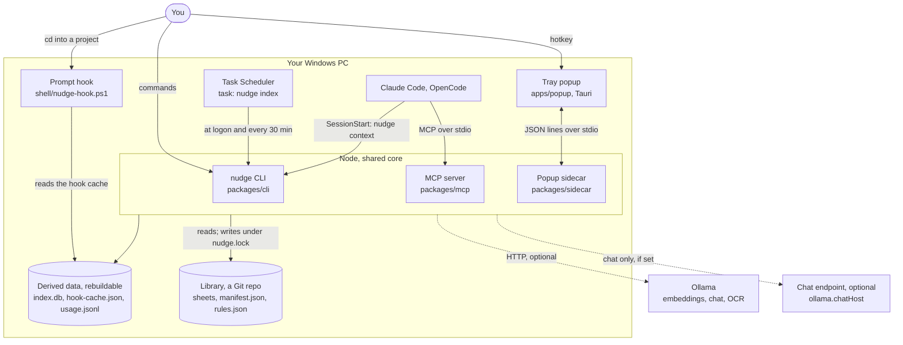
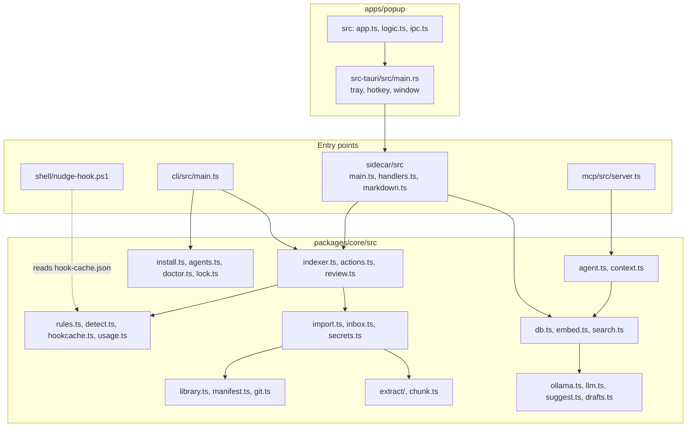
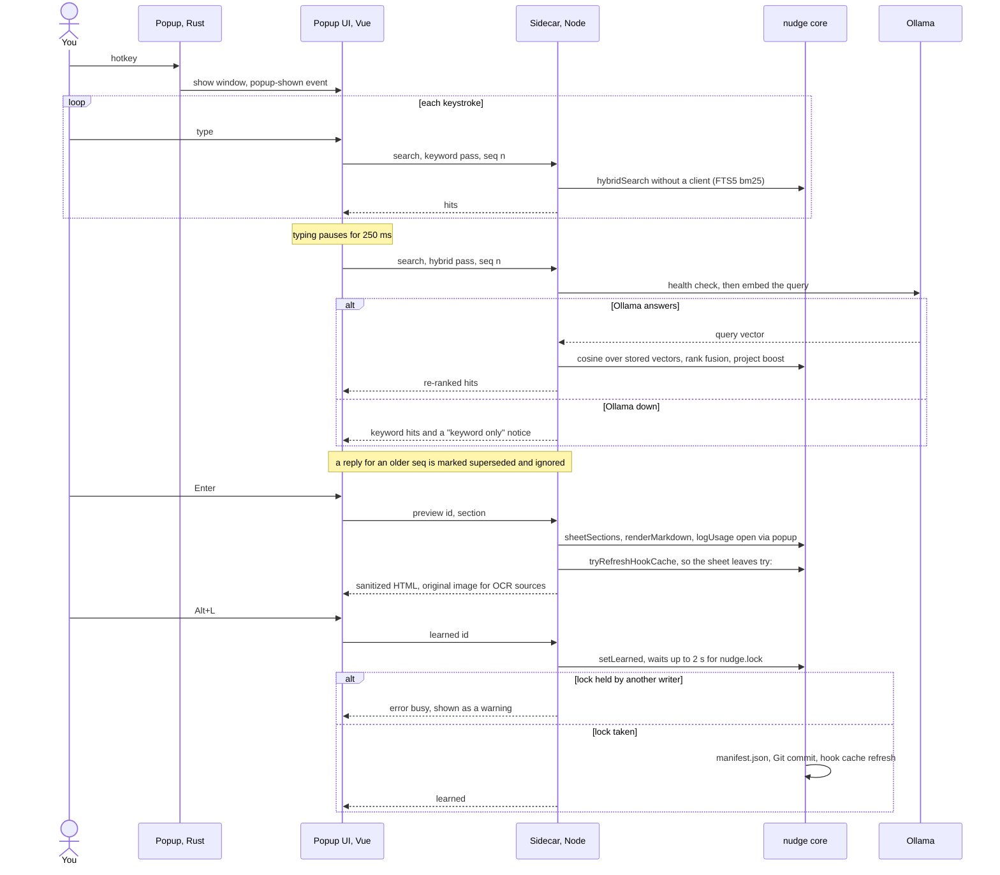
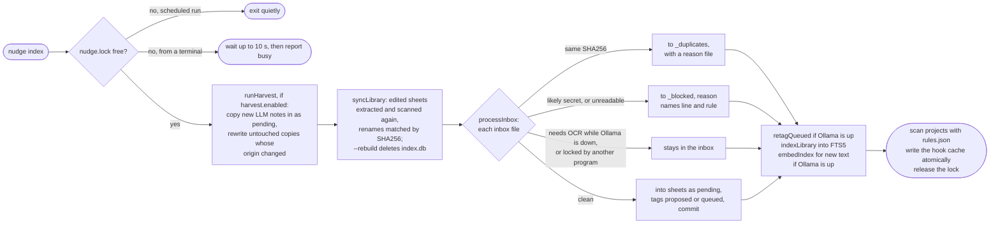
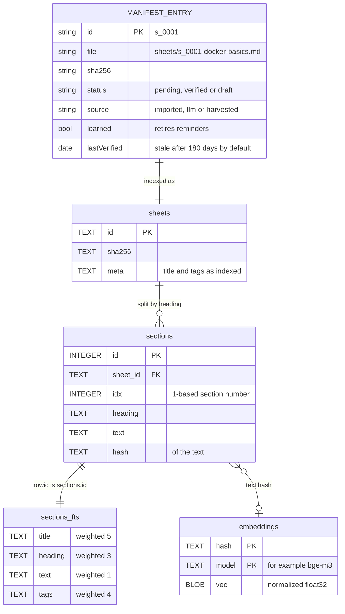

# Architecture

nudge is a local Windows tool that keeps every cheat sheet in one Git-tracked library and puts the right ones in front of you: a line in the PowerShell prompt when you enter a project, an index and MCP tools for coding agents, and a hotkey popup with live search. It is a TypeScript monorepo that Node 24 runs directly (no build step), plus a small Tauri tray app. Slow work (extraction, OCR, embeddings, project scans) happens in `nudge index`, run on demand and by Task Scheduler; the prompt hook, the MCP server and the CLI never depend on a running service.

## System context

What runs where, and everything it talks to. Ollama is optional: every path falls back to keyword search when it is down.

The prompt hook also records the project you entered in `last-project.json`, and starts a hidden `nudge scan` only for a project folder the cache does not know yet. Chat goes to `ollama.chatHost` instead of the Ollama host only when that setting is present; with `ollama.chatApi: "openai"` it uses the OpenAI-compatible `/v1/chat/completions` API.

## Components

The core library holds all logic; the four entry points are thin. The Rust side of the popup only owns the tray, the hotkey and the window, and relays JSON lines to the sidecar.

## Entry points

Each entry point is thin: it parses its input, loads `config.json` for that call and hands the work to `@nudge/core`.

| Entry point | Started by | What it does | What it writes |
|---|---|---|---|
| `nudge` CLI, `packages/cli/src/main.ts` | You, `bin\nudge.cmd` once it is on PATH, and Task Scheduler (`conhost.exe --headless node main.ts index --scheduled`, at logon and every 30 minutes) | 16 commands (`nudge help`); arguments parsed with `parseArgs` from `node:util` | Library and data folder, always under `nudge.lock`; a scheduled run logs to `logs\index.log` |
| Prompt hook, `shell/nudge-hook.ps1` | The marked block `nudge install` adds to the PowerShell 7 and 5.1 profiles; it wraps `prompt` | On a folder change, finds the project in `hook-cache.json` and prints one line | `last-project.json` (current project and "try:" rotation); starts a hidden `nudge scan` for an unknown project |
| MCP server, `packages/mcp/src/server.ts` | Claude Code (registered with `claude mcp add-json --scope user`) and OpenCode (`mcp.nudge` in `opencode.json`), over stdio | `nudge_search`, `nudge_get`, `nudge_for_project`; results wrapped as reference data | An `agent_fetch` line in `usage.jsonl`; a hook cache refresh when the lock is free |
| Session index, `nudge context` | Claude Code's SessionStart hook in `~/.claude/settings.json`; OpenCode's plugin `plugins/nudge-context.ts` through `experimental.chat.system.transform` | Prints at most 10 matched sheets in about 1,200 characters, drafts left out (`packages/core/src/context.ts`) | Nothing |
| Popup, `apps/popup/src-tauri/src/main.rs` | The HKCU Run value `nudge popup` at logon (with `--node` and `--sidecar`), or by hand; a second start shows the running one | Tray icon, global hotkey, a hidden pre-rendered window that hides when it loses focus | `logs\popup.log`, including the hotkey to painted time from `shown_ack`; the WebView2 profile in `webview\` |
| Sidecar, `packages/sidecar/src/main.ts` | The popup, restarted at most 5 times a minute | JSON line methods `ping`, `hello`, `search`, `preview`, `learned`, `verify`, `approve`, `openFile`, `openLink` (`handlers.ts`) | Usage events and manifest changes through core, waiting at most 2 s for the lock |

## A popup search, from hotkey to a learned sheet

The window is created hidden and already rendered at startup, so the hotkey only shows it. The Rust side logs the time from hotkey to the first painted frame in `logs\popup.log`. Every keystroke gets a keyword pass; a hybrid pass follows when typing pauses, and replies for older keystrokes are dropped. Messages between the UI and the sidecar pass through the Rust process, which the diagram leaves out.

## nudge index

The one place where slow work happens. Task Scheduler runs it at logon and every 30 minutes; a scheduled run that finds the lock taken exits quietly.

## Data model

`manifest.json` in the library is the source of truth. `index.db` (SQLite in WAL mode) is derived from it and from the sheet files, so `nudge index --rebuild` can recreate it at any time. Vectors are keyed by the hash of the text they embed, so an edit re-embeds only the sections that changed.

`openDb` in `db.ts` creates this schema at version 3 (`PRAGMA user_version`) and migrates older index files in place. The FTS5 table uses the `porter unicode61 remove_diacritics 2` tokenizer.

## Files on disk

| Where | File | Written by | Purpose |
|---|---|---|---|
| Library (default `%USERPROFILE%\nudge-library`, a Git repo) | `sheets\<id>-<slug>.<ext>` | Import | Imported sheets |
| | `drafts\<id>-<slug>.md` | `nudge suggest --save` | LLM drafts until `nudge approve` |
| | `ocr\<sha256>.txt` | Import, `nudge index` | OCR text, so a rebuild needs no vision model |
| | `manifest.json` | Every library change | One entry per sheet: the record of truth |
| | `rules.json`, `tags.json` | Seeded with defaults (19 rules), then edited by you; `tags.json` also by review | Project signature rules; tag aliases |
| | `gap-ignores.json` | `nudge ignore-gap` | Gaps silenced everywhere or per project |
| | `harvest-seen.json` | `nudge harvest`, `nudge review --reject` | Every harvested origin: its last hash, the sheet it became, or that you rejected it |
| | `inbox\`, `inbox\_blocked\`, `inbox\_duplicates\` | You, `nudge index` | Drop folder (ignored by Git); parked files with `.reason.txt` beside them |
| `%APPDATA%\nudge\` | `config.json` | You, or `nudge add` with defaults | Machine settings |
| | `backups\run-key.reg.nudge-backup-<time>` | `nudge install` | Run key backup before the popup value is replaced |
| `%LOCALAPPDATA%\nudge\` (rebuildable) | `index.db` | Import, `nudge index` | Sections, FTS5, vectors |
| | `extract-cache\<sha256>.txt` | Import, `nudge index` | Extracted text that passed the secret scan |
| | `hook-cache.json` | `nudge index`, `nudge scan`, actions that refresh it | What the prompt hook reads |
| | `last-project.json` | The prompt hook | Current project and "try:" rotation, read by search and the popup |
| | `usage.jsonl` | `nudge open`, popup, MCP `nudge_get`, learned | Usage events: `open`, `agent_fetch`, `learned` |
| | `nudge.lock` | Any writer | Single-writer lock (holder pid, time, command) |
| | `pending-allow.json`, `suggestions.json` | `nudge allow` before import; `nudge suggest` | Allowlist entries for files not imported yet; the last suggestion list for `--save <n>` |
| | `logs\index.log`, `logs\popup.log`, `webview\` | Scheduled index; popup | Logs; the popup's WebView2 profile |

Deleting `%LOCALAPPDATA%\nudge\` loses usage history, the "try:" rotation and allowlist entries for files not imported yet; `nudge index --rebuild` recreates the rest from the library.

## Configuration

`packages/core/src/config.ts` validates `%APPDATA%\nudge\config.json` with zod and fills defaults: `library`, `roots`, `ollama` (`host`, `embedModel`, `chatModel`, `visionModel`, optional `chatHost`, `chatApi`, `chatApiKeyEnv`), `staleAfterDays` (180), `unusedAfterDays` (30), `hotkey` (`Ctrl+Alt+Space`), `ocrMaxPages` (50) and `harvest` (`enabled` false, `sources`, `maxPerRun` 25). The CLI, the MCP server and the sidecar read it on every call, so edits apply without restarting the MCP server or the popup. The prompt hook never reads it; it only reads the hook cache. `chatApiKeyEnv` holds the name of an environment variable, never the token itself. The README lists every setting and every environment variable the code reads.

## Trust boundaries

| Boundary | Risk | Where the code handles it |
|---|---|---|
| Files you import (CLI or inbox) | Secrets end up in a Git repo and in an AI prompt | `secrets.ts` `scanSecrets` runs on every import, OCR text included, before anything moves; `import.ts` `importPrepared`, `inbox.ts` `processInbox` parks blocked files in `_blocked` |
| A file tracked by another repo | Moving it silently deletes it there | `import.ts`: `trackingRepo` check asks first or needs `--yes` |
| Model replies (tags, suggestions, drafts) | Malformed or injected output | `llm.ts`, `suggest.ts`, `drafts.ts`: strict zod schemas, one retry at temperature 0, otherwise discarded; nothing a model returns is run |
| Project files read by `nudge suggest` | Prompt injection from a README | `suggest.ts` wraps them in `<project_files>` as untrusted data and drops items without a detected tag |
| Sheet text sent to agents | A sheet that reads like instructions | `agent.ts` `wrapReferenceData`: JSON inside `<reference_data>` that sheet text cannot close early |
| Sheet text shown in the popup | Script or tracking in a Markdown file | `sidecar/src/markdown.ts`: raw HTML escaped, only http, https and mailto links, images only from the library; CSP in `tauri.conf.json`; navigation guard in `main.rs` |
| Links clicked in the popup | Opening `file:` or custom schemes | `sidecar/src/handlers.ts` `openLink` allows http, https and mailto only |
| Your machine (profiles, scheduler, PATH, Run key, agent configs) | Unwanted or lost settings | `install.ts` and `agents.ts`: every change is planned and shown first, `--dry-run`, confirmation, backups; files with comments are never rewritten |
| Two writers at once | A torn manifest or cache | `lock.ts` `acquireLock`, `util.ts` `writeFileAtomic` (temp file then rename) |
| The network | Data leaving the machine | `ollama.ts` is the only HTTP client: it calls `ollama.host`, and for chat `ollama.chatHost` when that is set (with a bearer token read from the variable named in `chatApiKeyEnv`). Nothing else makes network calls; Git only pushes when you run `git push`. Tests make any call to port 11434 throw (`core/test/helpers.ts`) |

## Where to look in the code

| Question | Open |
|---|---|
| How does an import work, from file to commit? | `packages/core/src/import.ts` `importPrepared` |
| How are search results ranked? | `packages/core/src/search.ts` `hybridSearch`, `fuseRanks` |
| What does `nudge index` do, in order? | `packages/core/src/indexer.ts` `runIndex` |
| How is a project's type detected? | `packages/core/src/rules.ts` `detectTags`, `packages/core/src/detect.ts` `resolveProjectRoot` |
| How does the prompt hook stay fast? | `shell/nudge-hook.ps1` `Invoke-NudgeHook`, `packages/core/src/hookcache.ts` `serializeHookCache` |
| Which sheets get a "try:" reminder? | `packages/core/src/usage.ts` `unusedSheets` |
| What do agents see? | `packages/mcp/src/server.ts`, `packages/core/src/agent.ts`, `packages/core/src/context.ts` `buildContext` |
| How does the popup talk to Node? | `apps/popup/src-tauri/src/main.rs` `supervise`, `packages/sidecar/src/handlers.ts` `createHandlers` |
| How are keystroke searches scheduled? | `apps/popup/src/logic.ts` `SearchScheduler` |
| What does `nudge install` change? | `packages/core/src/install.ts` `planInstall`, `planPopupLogon`; `packages/core/src/agents.ts` `planAgents` |
| How do tests stay off the real machine? | `packages/core/test/helpers.ts` `setupEnv`, `fakeSystem`; `packages/core/test/fakeollama.ts` |

The reasons behind these choices, and what they cost, are in [decisions.md](decisions.md).
