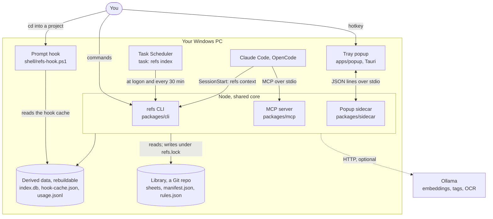
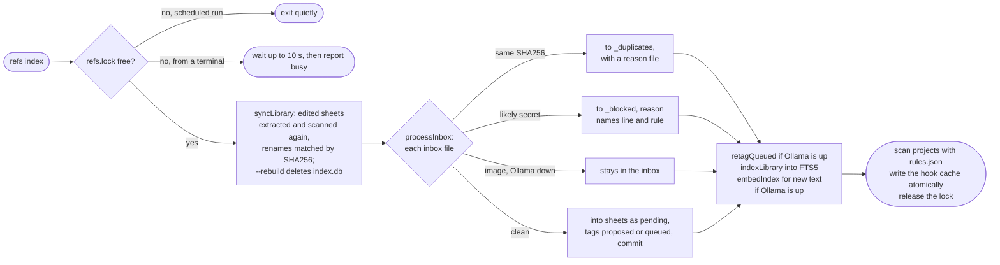
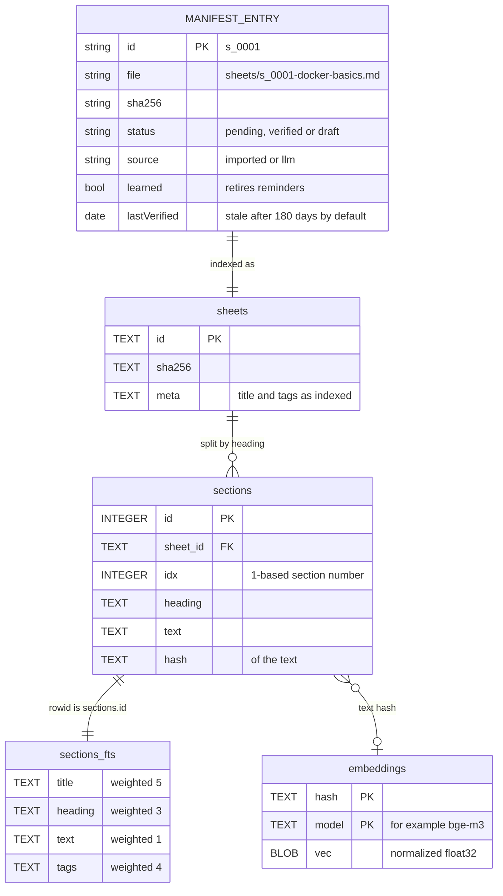

# Architecture

refs is a local Windows tool that keeps every cheat sheet in one Git-tracked library and puts the right ones in front of you: a line in the PowerShell prompt when you enter a project, an index and MCP tools for coding agents, and a hotkey popup with live search. It is a TypeScript monorepo that Node 24 runs directly (no build step), plus a small Tauri tray app. Slow work (extraction, OCR, embeddings, project scans) happens in `refs index`, run on demand and by Task Scheduler; the prompt hook, the MCP server and the CLI never depend on a running service.

## System context

What runs where, and everything it talks to. Ollama is optional: every path falls back to keyword search when it is down.

The prompt hook also records the project you entered in `last-project.json`, and starts a hidden `refs scan` only for a project folder the cache does not know yet.

## Components

The core library holds all logic; the four entry points are thin. The Rust side of the popup only owns the tray, the hotkey and the window, and relays JSON lines to the sidecar.

## A popup search, from hotkey to a learned sheet

The window is created hidden and already rendered at startup, so the hotkey only shows it (measured at 8 ms to visible, about 16 ms to the first painted frame). Every keystroke gets a keyword pass; a hybrid pass follows when typing pauses, and replies for older keystrokes are dropped. Messages between the UI and the sidecar pass through the Rust process, which the diagram leaves out.

## refs index

The one place where slow work happens. Task Scheduler runs it at logon and every 30 minutes; a scheduled run that finds the lock taken exits quietly.

## Data model

`manifest.json` in the library is the source of truth. `index.db` (SQLite in WAL mode) is derived from it and from the sheet files, so `refs index --rebuild` can recreate it at any time. Vectors are keyed by the hash of the text they embed, so an edit re-embeds only the sections that changed.

## Trust boundaries

| Boundary | Risk | Where the code handles it |
|---|---|---|
| Files you import (CLI or inbox) | Secrets end up in a Git repo and in an AI prompt | `secrets.ts` `scanSecrets` runs on every import, OCR text included, before anything moves; `import.ts` `importPrepared`, `inbox.ts` `processInbox` parks blocked files in `_blocked` |
| A file tracked by another repo | Moving it silently deletes it there | `import.ts`: `trackingRepo` check asks first or needs `--yes` |
| Model replies (tags, suggestions, drafts) | Malformed or injected output | `llm.ts`, `suggest.ts`, `drafts.ts`: strict zod schemas, one retry at temperature 0, otherwise discarded; nothing a model returns is run |
| Project files read by `refs suggest` | Prompt injection from a README | `suggest.ts` wraps them in `<project_files>` as untrusted data and drops items without a detected tag |
| Sheet text sent to agents | A sheet that reads like instructions | `agent.ts` `wrapReferenceData`: JSON inside `<reference_data>` that sheet text cannot close early |
| Sheet text shown in the popup | Script or tracking in a Markdown file | `sidecar/src/markdown.ts`: raw HTML escaped, only http, https and mailto links, images only from the library; CSP in `tauri.conf.json`; navigation guard in `main.rs` |
| Links clicked in the popup | Opening `file:` or custom schemes | `sidecar/src/handlers.ts` `openLink` allows http, https and mailto only |
| Your machine (profiles, scheduler, PATH, Run key, agent configs) | Unwanted or lost settings | `install.ts` and `agents.ts`: every change is planned and shown first, `--dry-run`, confirmation, backups; files with comments are never rewritten |
| Two writers at once | A torn manifest or cache | `lock.ts` `acquireLock`, `util.ts` `writeFileAtomic` (temp file then rename) |
| The network | Data leaving the machine | Only the configured Ollama host is called (`ollama.ts`); tests make any call to port 11434 throw (`core/test/helpers.ts`) |

## Where to look in the code

| Question | Open |
|---|---|
| How does an import work, from file to commit? | `packages/core/src/import.ts` `importPrepared` |
| How are search results ranked? | `packages/core/src/search.ts` `hybridSearch`, `fuseRanks` |
| What does `refs index` do, in order? | `packages/core/src/indexer.ts` `runIndex` |
| How is a project's type detected? | `packages/core/src/rules.ts` `detectTags`, `packages/core/src/detect.ts` `resolveProjectRoot` |
| How does the prompt hook stay fast? | `shell/refs-hook.ps1` `Invoke-RefsHook`, `packages/core/src/hookcache.ts` `serializeHookCache` |
| Which sheets get a "try:" reminder? | `packages/core/src/usage.ts` `unusedSheets` |
| What do agents see? | `packages/mcp/src/server.ts`, `packages/core/src/agent.ts`, `packages/core/src/context.ts` `buildContext` |
| How does the popup talk to Node? | `apps/popup/src-tauri/src/main.rs` `supervise`, `packages/sidecar/src/handlers.ts` `createHandlers` |
| How are keystroke searches scheduled? | `apps/popup/src/logic.ts` `SearchScheduler` |
| What does `refs install` change? | `packages/core/src/install.ts` `planInstall`, `planPopupLogon`; `packages/core/src/agents.ts` `planAgents` |
| How do tests stay off the real machine? | `packages/core/test/helpers.ts` `setupEnv`, `fakeSystem`; `packages/core/test/fakeollama.ts` |

The reasons behind these choices, and what they cost, are in [decisions.md](decisions.md).
